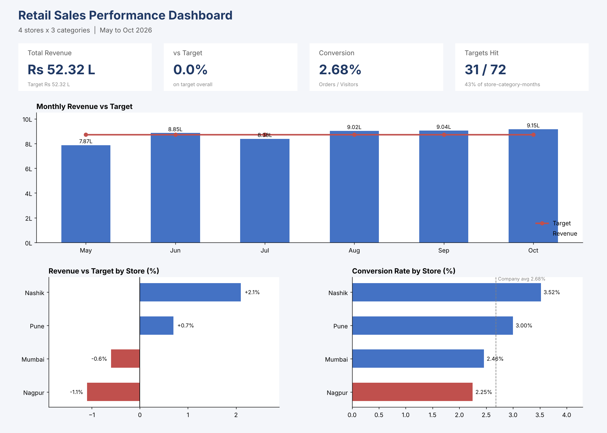

# Retail Sales Performance Analysis (Excel + Python)

**Which stores and categories miss target, and why?** An end-to-end analysis of 6 months of sales for a 4-store retail chain, following the 7-step analyst workflow, from messy raw data to a dashboard and recommendations for next quarter's targets.

**Tools:** Python (Pandas) for cleaning and exploration · Excel (formulas, pivot tables, charts) for KPIs and the dashboard

---

## Executive summary

- **Situation:** 4 stores earned **Rs 52.32 lakh** in May to Oct 2026, exactly on target (Rs 52.32 lakh).
- **Complication:** only **31 of 72** store-category-months (43%) hit target. **May (-9.7%)** and **Nagpur (-1.1%)** were the weak spots, and Nagpur's problem is **low conversion (2.25% vs 2.68% company average)**, not footfall.
- **Resolution for Q1 2027:**
  1. Run an April footfall campaign so May does not repeat (May had the lowest visitors of the period).
  2. Mumbai to copy Nashik's footwear display and stock mix; Mumbai Footwear was the largest single gap (Rs 27,560).
  3. Fix Nagpur's conversion (stock availability, floor staff at peak hours, accessories pricing). At the company conversion rate Nagpur would earn about **Rs 2.8 lakh more**.

---

## 1. Define: business problem

**Stakeholder:** Head of Retail (4 stores: Mumbai, Pune, Nashik, Nagpur).
**Decision:** set Q1 2027 targets per store and category, and decide which stores get extra marketing budget.

**Problem statement:** Measure each store's and category's Revenue vs Target, Conversion rate and Average Order Value (AOV) for May to Oct 2026. We don't know which stores and categories consistently miss target, or whether the cause is fewer visitors, lower conversion or smaller orders. The answer will drive realistic Q1 2027 targets and the marketing budget split.

## 2. Collect: data dictionary

One row = one store x one category x one month (4 x 3 x 6 = 72 rows expected).

| Column | Meaning | Type | Example |
|---|---|---|---|
| Month | Sales month | Date / ordinal | May-2026 |
| Store | Store city | Nominal | Pune |
| Region | Zone of the store | Nominal | West |
| Category | Apparel, Footwear, Accessories | Nominal | Apparel |
| Visitors | People who entered the store for that category in the month | Discrete | 3,859 |
| Orders | Bills / purchases | Discrete | 108 |
| Revenue | Sales value in Rs | Continuous | 87,704 |
| Target | Monthly revenue target in Rs | Continuous | 1,01,000 |

**Calculated KPIs:** Conversion % = Orders / Visitors · AOV = Revenue / Orders · Variance % = (Revenue - Target) / Target · Status = Hit if Revenue >= Target.

## 3. Clean (Python, Pandas)

Raw file: 74 rows with several quality issues. Clean file: 72 rows. See [`01_cleaning_explore.ipynb`](01_cleaning_explore.ipynb).

| Issue found | Business risk | Fix |
|---|---|---|
| 2 exact duplicate rows | Revenue counted twice | `drop_duplicates()` |
| Store names `'pune '`, `'NAGPUR'` | Stores split into extra groups | strip + standardise |
| **2 rows tagged to the wrong store** (found by a grain check: Mumbai had 16 rows, Pune and Nagpur 19) | Mumbai would lose ~Rs 1.4 lakh of revenue; Pune and Nagpur look better than reality | Re-assigned to Mumbai using Region and Target as evidence |
| `'Foot wear'` row that was really Apparel (target matched Nagpur Apparel) | Wrong category totals | Corrected to Apparel |
| Revenue stored as text (`'Rs 98,927'`) | Can't sum or compare | Removed `Rs` and commas, converted to number |
| 2 missing Visitors values | Conversion rate wrong for those rows | Filled with the **median of the same store + category** (an overall mean would have tripled one value and halved the other) |
| Month stored as text | Months sort alphabetically | Converted to date |

**Check after cleaning:** 72 rows, 18 per store, 6 per store-category, total revenue Rs 52,31,549.

## 4. Explore

- Nagpur was the weakest store: Rs 14.96 L vs target Rs 15.12 L (**-1.1%**). Mumbai also missed (-0.6%). Nashik (**+2.1%**) and Pune (+0.7%) beat target.
- May was the weakest month: Rs 7.87 L vs Rs 8.72 L (**-9.7%**). July also missed (-3.9%). Aug to Oct each beat target by 3-5%.
- Only **31 of 72** store-category-months (43%) hit target, so the overall "on target" hides a lot of misses.

## 5. Analyze (Excel): why does a store miss?

Revenue = Visitors x Conversion x AOV, so each store was broken down into the three drivers.

| Store | Visitors | Conversion | AOV (Rs) | vs Target |
|---|---|---|---|---|
| Mumbai | 77,208 | 2.46% | 901 | -0.6% |
| Nagpur | 59,544 | **2.25%** | **1,115** | **-1.1%** |
| Nashik | 31,785 | **3.52%** | 707 | **+2.1%** |
| Pune | 50,998 | 3.00% | 805 | +0.7% |
| **Total** | 2,19,535 | 2.68% | 888 | 0.0% |

**Finding:** Nagpur has the 2nd highest footfall and the highest bill size, but the lowest conversion. Its problem is turning visitors into buyers, not traffic or pricing.

**Store x category gaps:** Mumbai Footwear -Rs 27,560 (largest gap), Nagpur Accessories -Rs 14,787 (-8.2%), while Nashik Footwear beat target by Rs 12,910.

**Month drivers:** May had the lowest visitors (33,273 vs ~38,800 in Aug to Oct) while conversion was normal (2.65%). The May miss was a footfall problem.

> Note on method: conversion and AOV were recalculated from totals (Orders / Visitors), never by summing or averaging the monthly ratios.

## 6. Visualize: Excel dashboard

One page answering **when, who, why**:
1. **KPI cards:** Total revenue, vs target, conversion, targets hit
2. **Monthly Revenue vs Target** (bars + target line, axis from 0): when did we miss?
3. **Variance % by Store:** who missed?
4. **Conversion % by Store** (Nagpur highlighted): why did Nagpur miss?

## 7. Communicate: insights and recommendations

| # | Insight | Impact | Action (owner, target) |
|---|---|---|---|
| 1 | Nagpur converts only 2.25% of visitors (company 2.68%) despite high footfall and the highest AOV | At the company rate: ~255 more orders, **~Rs 2.8 lakh** more revenue | Nagpur store manager: check stock availability and floor staffing at peak hours, review accessories pricing; Q1 conversion target 2.6% |
| 2 | May revenue Rs 7.87 L vs Rs 8.72 L (-9.7%), all 4 stores missed; cause was low footfall, conversion was normal | Rs 84,635 below target in one month | Marketing: April pre-season footfall campaign; target May visitors >= 37,000 |
| 3 | Mumbai Footwear (gap Rs 27,560) and Nagpur Accessories (gap Rs 14,787) explain most of the miss, while Nashik Footwear beat target by Rs 12,910 | ~Rs 42,000 recoverable from two combos | Mumbai store manager: copy Nashik's footwear display and stock mix; category managers: set Q1 targets per store-category, not one flat target |

**What to check next:** stock-outs and staff rosters in Nagpur, footfall source data (ads, local events) for May, and last year's data to confirm seasonality.

## Frameworks used

- 7-step analysis workflow (Define, Collect, Clean, Explore, Analyze, Visualize, Communicate)
- Problem statement (Metric, Baseline, Problem, Decision)
- KPI / driver tree: Revenue = Visitors x Conversion x AOV
- Variance analysis (actual vs target) and trend analysis
- SCR (Situation, Complication, Resolution) for the executive summary

## Files

| File | What it is |
|---|---|
| `data/store_sales_raw.csv` | Raw data as received (74 rows, with quality issues) |
| `01_cleaning_explore.ipynb` | Python cleaning and exploration (Steps 3-4) |
| `data/store_sales_clean.csv` | Clean data (72 rows) |
| `Cleaned_Store_Data.xlsx` | Excel KPIs, pivot tables and dashboard (Steps 5-6) |
| `Retail_Sales_Performance_slides.pdf` | 12-slide case study (LinkedIn carousel) |
| `images/dashboard_preview.png` | Dashboard layout |

*Data: practice dataset for a fictional 4-store retail chain, built for this project.*
